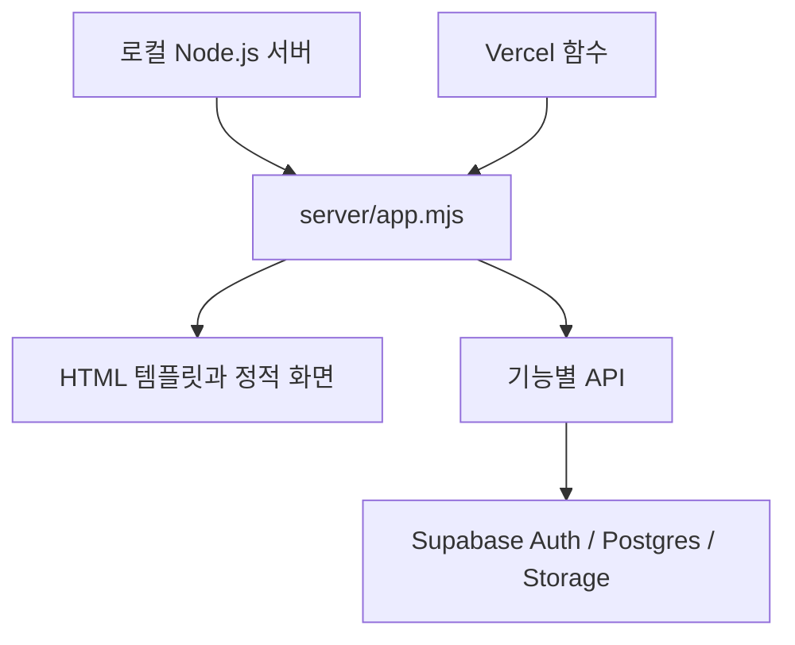

<div align="center">
  
  <h1>Kyohoon Jin</h1>
  <p>진교훈의 포트폴리오, 연구 작업 공간, 개인 기록</p>
  <p><a href="https://www.kyohoon.app">홈페이지</a> &nbsp;|&nbsp; <a href="https://www.kyohoon.app/resume">Resume</a> &nbsp;|&nbsp; <a href="https://www.kyohoon.app/work/demos">연구 데모</a> &nbsp;|&nbsp; <a href="https://www.kyohoon.app/personal/gallery">마스코트 갤러리</a></p>
</div>

## 사이트 둘러보기

Selectstar에서 AI 모델 학습에 쓰이는 데이터를 만들고, 모델을 평가하는 방법을 연구합니다. 이 사이트에 경력과 연구 결과를 공개하고, 팀 업무와 논문 작업을 관리합니다.

| 공간 | 하는 일 | 접근 |
| --- | --- | --- |
| [Home](https://www.kyohoon.app) | 네 공간의 입구. 링크에 마우스를 올리거나 키보드로 초점을 맞추면 마스코트가 해당 공간의 모습으로 바뀝니다. | 공개 |
| [Resume](https://www.kyohoon.app/resume) | 경력, 학력, 논문, 프로젝트와 연락처를 모은 공개 이력서입니다. | 공개 |
| [Selectstar](https://www.kyohoon.app/work) | 연구일지, 팀 리소스, 연구 데모, 품의 사용내역을 한곳에서 엽니다. | 등록 계정, 연구 데모는 공개 |
| [Paper](https://www.kyohoon.app/paper) | 리뷰어로서 쓸 논문 리뷰와 저자로서 준비할 리뷰탈을 관리합니다. | 등록 계정 |
| [Personal](https://www.kyohoon.app/personal) | 여행 기록, 마스코트 갤러리, 마크다운 에디터를 모았습니다. | 여행 기록과 갤러리는 공개, 에디터는 등록 계정 |
| [설정](https://www.kyohoon.app/settings) | 라이트, 다크, 시스템 테마와 홈 시작 애니메이션을 선택합니다. 배경 이미지와 움직임, LLM도 설정할 수 있습니다. | 화면 설정은 공개, 배경과 LLM 설정은 등록 계정 |

### Selectstar

| 도구 | 기능 |
| --- | --- |
| [연구일지](https://www.kyohoon.app/work/app/index.html) | 로드맵, 연간 조망, 연구 후보, L3 연구축과 연구 노트를 관리합니다. 연구 유형, 상태, 담당자를 복수 선택해 필터링하고 일정과 담당자별 주간 및 월간 배정 비중을 확인합니다. 연구 노트에는 참고 링크와 논문을 첨부할 수 있습니다. |
| [팀 리소스](https://www.kyohoon.app/work/team-resources) | Notion의 주간 업무 기록을 바탕으로 과업별 배분과 월별 변화를 확인합니다. 주 단위와 월 단위 보기, 주간 원본 기록 링크를 제공합니다. |
| [연구 데모](https://www.kyohoon.app/work/demos) | [Ontology](https://www.kyohoon.app/work/demos/ontology/)에서 문서 속 개념과 관계를 탐색하고, [Document Parsing](https://www.kyohoon.app/work/demos/document-parsing/)에서 문서 레이아웃을 분석하고 텍스트와 표를 추출한 결과를 확인합니다. |
| [품의 사용내역](https://www.kyohoon.app/work/expenses/) | 월별 카드 내역 엑셀을 가져와 품의별 예산과 사용액을 비교하고 원본 파일을 관리합니다. |

### Paper

- **논문 리뷰 준비**에서는 요약, 강점, 약점과 기타 의견을 항목별로 정리해 영문 리뷰를 작성합니다.
- **논문 리뷰탈 준비**에서는 리뷰어별 쟁점과 대응 근거를 정리하고, 리뷰 원문 번역과 영문 답변 초안 작성을 보조합니다.
- 작업별로 학회와 마감일, 진행 상태, 글자 수 제한을 설정할 수 있습니다. PDF 첨부는 선택이며, 초안은 자동 저장되고 마크다운으로 내보낼 수 있습니다. 모델과 Reasoning Effort는 공통 설정에서, 프롬프트는 작업 화면에서 바꿉니다.
- **AI 컨퍼런스 데드라인** 화면은 준비 중입니다.

### Personal

| 도구 | 기능 |
| --- | --- |
| [여행의 흔적](https://www.kyohoon.app/personal/travel) | 지구본에서 방문 지역을 선택해 사진과 기록을 봅니다. Editor는 여행 또는 학회 방문으로 분류해 기록을 편집하고 표시 색을 지정할 수 있습니다. |
| [마스코트 갤러리](https://www.kyohoon.app/personal/gallery) | 마스코트의 여러 모습을 검색하고, 8방향으로 돌려보거나 걷는 모습을 재생합니다. 원본 이미지를 받을 수 있고, 브라우저에 저장한 좋아요는 ZIP으로 묶어 내려받을 수 있습니다. |
| [마크다운 에디터](https://www.kyohoon.app/personal/markdown) | 문서를 폴더에 정리하고, 편집기와 미리보기를 나란히 띄우거나 각각 볼 수 있습니다. 문서 테마, 자동 저장, PDF 내보내기를 지원합니다. |

## 코드 구조

로컬 Node.js 서버와 Vercel 함수가 같은 HTTP 핸들러를 사용합니다. 핸들러가 경로에 따라 HTML이나 정적 파일을 제공하고, 데이터가 필요한 요청은 기능별 모듈에서 처리합니다. Resume는 React와 Tailwind CSS로 작성해 Webpack으로 빌드합니다.



| 수정할 내용 | 먼저 볼 파일 |
| --- | --- |
| 홈과 공간별 첫 화면, 공통 탐색 | [views/pages.mjs](views/pages.mjs), [views/navigation.mjs](views/navigation.mjs), [public/home.js](public/home.js) |
| Resume의 경력, 논문, 프로젝트 | [경력 데이터](legacy/resume/src/experienceData.js), [논문 데이터](legacy/resume/src/PublicationsData.js), [프로젝트 데이터](legacy/resume/src/projectsData.js), [Resume 빌드](scripts/build-resume.mjs) |
| Selectstar 공통 메뉴와 연구일지 | [views/work-shell.mjs](views/work-shell.mjs), [work-app/](work-app/), [scripts/sync-work-shell.mjs](scripts/sync-work-shell.mjs) |
| 팀 리소스, 품의, 연구 데모 | [팀 리소스 화면](views/team-resources.html), [품의 화면](work-expenses/), [연구 데모](work-demos/) |
| 논문 리뷰와 리뷰탈, LLM 연동 | [public/paper.js](public/paper.js), [server/paper-routes.mjs](server/paper-routes.mjs), [server/paper-providers.mjs](server/paper-providers.mjs) |
| 여행 기록과 마스코트 이미지 | [public/travel/](public/travel/), [public/gallery/](public/gallery/), [public/mascot/](public/mascot/) |
| 마크다운 편집과 PDF 출력 | [public/markdown-editor.js](public/markdown-editor.js), [server/markdown-routes.mjs](server/markdown-routes.mjs), [server/markdown-pdf.mjs](server/markdown-pdf.mjs) |
| 공통 스타일과 테마 | [public/kh-system.css](public/kh-system.css), [public/kh/](public/kh/), [public/theme.js](public/theme.js) |
| 요청 처리, 접근 정책, 자동 테스트 | [server/app.mjs](server/app.mjs), [supabase/](supabase/), [tests/](tests/) |

Resume의 빌드 결과는 `public/resume/`에 생성됩니다. Selectstar 공통 메뉴를 수정한 뒤에는 `node scripts/sync-work-shell.mjs`로 정적 화면에도 반영합니다.

## 로컬 실행

Node.js 22 이상과 npm이 필요합니다.

```sh
npm ci
npm run build
npm run dev
```

개발 서버는 <http://127.0.0.1:3000>에서 실행됩니다. 로그인과 원격 데이터가 필요한 기능을 확인하려면 [.env.example](.env.example)을 참고해 `.env.local`에 `SUPABASE_URL`과 `SUPABASE_ANON_KEY`를 설정합니다. 로컬에서 마크다운 PDF를 내보낼 때는 Chrome 또는 Edge가 필요하며, 실행 파일을 자동으로 찾지 못하면 `CHROME_PATH`를 설정합니다.

| 명령 | 용도 |
| --- | --- |
| `npm run build` | 사전 테스트, Resume 빌드, 연구일지 번들 생성, 타입 및 배포 자산 검사 |
| `npm test` | 전체 자동 테스트 실행 |
| `npm run typecheck` | TypeScript 타입 검사 |
| `npm run build:resume` | Resume만 다시 빌드 |
| `npm start` | 운영 모드로 로컬 서버 실행 |

업무 자료를 가져온 사본이 `private/work/`에 있으면 개발 서버에서 `/work/preview`로 열 수 있습니다. 미리보기에서 수정한 내용은 로컬 사본에 저장됩니다.

## 인증과 배포

이메일과 비밀번호는 Supabase Auth에서 확인합니다. 보호된 화면과 API는 활성 `workspace_members` 등록이 필요합니다. Reader는 허용된 데이터를 열람하고, Editor는 기능별 권한에 따라 저장할 수 있습니다. 세션은 HttpOnly 쿠키로 관리하며 3시간 동안 활동이 없으면 만료됩니다.

팀 리소스 화면은 Supabase의 `team_resource_snapshots`에서 현재 스냅샷을 읽습니다. [스냅샷 갱신 스크립트](scripts/team-resources-sync.mjs)는 Notion에서 정리한 데이터를 갱신용 SQL로 변환합니다. 테이블과 접근 정책은 [Supabase SQL](supabase/)에서 확인할 수 있습니다.

Vercel은 GitHub의 `main`을 배포합니다. [vercel.json](vercel.json)에서 빌드 명령과 라우팅, 함수에 포함할 파일을 설정하며 [api/index.mjs](api/index.mjs)가 운영 진입점입니다. 변경 이력은 [커밋 기록](https://github.com/fhzh123/kyohoon_personal/commits/main/)에서 볼 수 있습니다.
